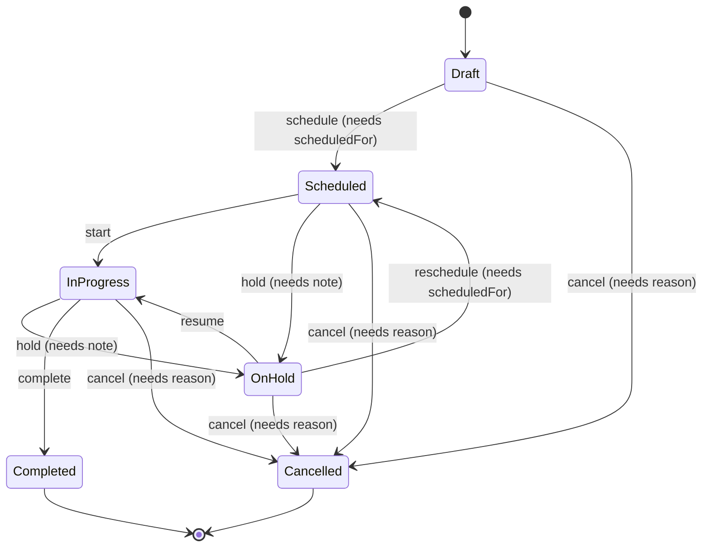

# Sitework: Project Plan

An API-driven app for coordinating field work across many sites. Each record is a **Job** pinned to a geographic location, and it moves through a defined lifecycle (Draft → Scheduled → In Progress → Completed). The stack is Next.js (UI), .NET (API), PostgreSQL + PostGIS (data), and AWS EKS (hosting). Infrastructure is provisioned with Terraform and the app is deployed with Helm.

> "Sitework" and "Job" are working names. Renaming the domain (e.g. *Inspection*, *Work Order*, *Site Visit*) changes nothing structural.

> **Status (2026-10-13):** milestones 0–6 and stretch goals 1, 3 and 4 are built, tested, and verified on kind. That includes the CI pipeline, which is green on GitHub. It is deployed to AWS at `sitework.stephendavid.dev`. The account is on AWS's Free plan, which rejects the planned `t4g.medium` nodes, so the cluster runs x86 Free Tier `m7i-flex.large` nodes; the images are multi-arch. Releases are made from a workstation with `make aws-release`, because the organization's SCP blocks the GitHub OIDC provider. Where implementation departed from this plan, the text below has been updated and the reasoning recorded in [docs/adr](docs/adr).

---

## 1. Scope and assumptions

| In scope | Out of scope (unless asked) |
|---|---|
| Full CRUD on Jobs, plus lifecycle transitions with server-enforced rules | **Logins / authorization: deliberately excluded for now.** The site is public, so it's protected by rate limiting instead (§9). The design leaves room to add login later (§11) |
| Map + list UI with filtering, data entry, and map-based location picking | Multi-tenant orgs, user management |
| Public HTTPS on a subdomain (Route 53 + ACM), deployed to your own AWS account from your personal GitHub | |
| Loading, empty, error, conflict and validation states across the UI | File attachments / photos |
| A single `dev` environment on AWS, reproducible from Terraform | Multi-region, DR, prod-grade HA |
| Local dev loop (Docker Compose) and a local Kubernetes loop (kind + Helm) | Mobile app / offline sync |

---

## 2. Domain model

### Job

| Field | Type | Notes |
|---|---|---|
| `id` | UUID v7 | `Guid.CreateVersion7()`, which sorts by time |
| `reference` | string | Human-friendly, e.g. `JOB-1042` (Postgres sequence) |
| `title` | string (1–200) | required |
| `description` | string (≤ 4000) | optional |
| `status` | enum | see lifecycle below; changed **only** via transitions |
| `priority` | enum | `Low`, `Normal`, `High`, `Urgent` |
| `location` | `{ latitude, longitude }` | required; stored as `geometry(Point, 4326)` with a GiST index. Radius queries use spheroid distance functions ([ADR 0003](docs/adr/0003-postgis-geometry.md)) |
| `siteName` / `address` | string | optional, free text (geocoding is a stretch goal) |
| `assignee` | string | optional free text (no user model yet) |
| `scheduledFor` | timestamptz | required to enter `Scheduled` |
| `completedAt` | timestamptz | set by the `Completed` transition |
| `createdAt` / `updatedAt` | timestamptz | via an injected `TimeProvider` (testable) |
| `version` | uint | Postgres `xmin` concurrency token, used for optimistic locking |

### JobStatusChange (audit trail)
`id, jobId, from, to, note, changedAt`. One row is written on every transition, and the UI shows them as a timeline.

### Lifecycle



Rules enforced by the API:
- `Completed` and `Cancelled` are **terminal**. A terminal job is read-only, and edits return `409`.
- `status` can't be changed through `PUT`. It changes only via `POST /jobs/{id}/transitions`.
- `DELETE` is allowed only from `Draft` or `Cancelled`. Any other state returns `409` with a "cancel it first" ProblemDetails.
- The transition table is a plain, table-driven domain class with no state-machine library, so it is easy to read and exhaustively unit-test.
- Every Job response includes `allowedTransitions` (e.g. `[{ to: "OnHold", requiresNote: true }]`). **The UI renders action buttons from this list and never duplicates lifecycle logic.**

---

## 3. Architecture

```mermaid
flowchart LR
    U[Browser] -.DNS lookup.-> R53[Route 53<br/>subdomain zone]
    U -->|HTTPS · ACM cert| ALB[AWS ALB<br/>via Load Balancer Controller]
    subgraph EKS["EKS cluster (private subnets)"]
        ALB -->|/api/*| API[sitework-api<br/>.NET 10]
        ALB -->|/*| WEB[sitework-web<br/>Next.js standalone]
        MIG[migrations Job<br/>Helm pre-upgrade hook] 
        ESO[External Secrets<br/>Operator]
        EDNS[ExternalDNS]
    end
    EDNS -->|alias record → ALB| R53
    API --> RDS[(RDS PostgreSQL 17<br/>+ PostGIS)]
    MIG --> RDS
    SM[Secrets Manager<br/>RDS-managed password] --> ESO -->|K8s Secret| API
    ECR[ECR] -.images.-> EKS
    GH[GitHub Actions<br/>OIDC role] -.push / helm upgrade.-> ECR & EKS
```



Key decisions:
- **Same origin for UI and API.** The ingress routes `/api/*` to the .NET service and everything else to Next.js. That means no CORS in production and nothing environment-specific baked into the Next.js build: the browser calls the relative path `/api/...`. Locally, Next.js `rewrites` proxy `/api` to `localhost:5080`.
- **Client-side data fetching with TanStack Query.** This is where the brief's loading/error/dynamic-state requirements live. Pages are thin server components that render client components.
- **The OpenAPI contract is the source of truth.** The .NET API emits `openapi.json` at build time, and the web app generates its TypeScript types from it. CI fails if the two drift.
- **Database migrations run as a Helm hook Job** (the API image with `--migrate`) before new API pods roll out, never at app startup ([ADR 0004](docs/adr/0004-migrations-as-helm-hook.md)).
- **HTTPS on a subdomain via its own Route 53 zone.** Terraform creates a hosted zone just for the subdomain, delegates it from the parent domain, and issues a DNS-validated ACM certificate. In-cluster, ExternalDNS points the subdomain at whatever ALB the Load Balancer Controller creates, so Terraform never needs to know the ALB's name. ExternalDNS is only allowed to touch the subdomain zone, never the parent domain.

---

## 4. Tech stack and libraries

Versions are the latest stable releases as of 2026-10-13, and they get pinned exactly at scaffold time.

### Frontend (`apps/web`)

| Concern | Choice | Why |
|---|---|---|
| Framework | **Next.js 16.4** (App Router, Turbopack, `output: "standalone"`) + **React 19.3** + TypeScript (strict) | Required. Standalone output gives a small container image |
| Package manager | **pnpm 10** (already installed) | Fast, strict |
| Server state | **@tanstack/react-query 5** | Caching, retries, `isPending`/`isFetching`/`error`, optimistic mutations with rollback |
| API client | **openapi-typescript 7** + **openapi-fetch 0.17** | Types generated from the .NET contract, a tiny runtime, no hand-written DTOs |
| URL state | **nuqs 2** | Filters, selected job and map viewport live in the URL, so they are shareable and survive a reload |
| Forms | **react-hook-form 7** + **zod 4** (`@hookform/resolvers`) | Client validation mirrors the API constraints; server ProblemDetails errors are mapped back onto fields |
| Map | **maplibre-gl 6** + **@vis.gl/react-maplibre 8** | Open source, no API key. Built-in GeoJSON clustering. Loaded with `next/dynamic({ ssr: false })` |
| Map tiles | **OpenFreeMap** (`tiles.openfreemap.org/styles/liberty`) | Free vector tiles, no key or signup; swappable via env |
| UI | **Tailwind CSS 4** + **shadcn/ui** (Radix) + **lucide-react** + **sonner** (toasts) | Accessible primitives that live in the repo, not in a dependency |
| Unit/component tests | **Vitest 5** + **Testing Library** + **MSW 3** | MSW drives loading/error/409 scenarios against the real fetch client |
| E2E | **Playwright 1.64** | Runs the golden path against the Compose stack |
| Lint/format | ESLint (next config) + Prettier | |

### Backend (`apps/api`)

| Concern | Choice | Why |
|---|---|---|
| Runtime | **.NET 10 (LTS)**, SDK 10.0.301 already installed; pinned via `global.json` | Current LTS |
| Web | **ASP.NET Core Minimal APIs** with route groups, organised by feature folders (`Features/Jobs/*`) | Small surface, no controller ceremony; a single project rather than a 4-project "clean architecture" split |
| Validation | Built-in .NET 10 minimal-API validation (`AddValidation()` + DataAnnotations), plus domain guards in the lifecycle | No extra dependency |
| Errors | `AddProblemDetails()` + an exception handler, giving RFC 9457 ProblemDetails everywhere | The UI has a single error shape to parse |
| Data | **EF Core 10** + **Npgsql.EntityFrameworkCore.PostgreSQL 10.0.3** + **.NetTopologySuite** plugin | PostGIS `geography` points, `ST_DWithin` (radius) and envelope (bbox) queries translated by LINQ |
| Migrations | `dotnet-ef` (local tool manifest) to author; the API image's `--migrate` command applies them in the Helm hook Job | No extra image to build; exits non-zero on failure |
| API docs | **Microsoft.AspNetCore.OpenApi 10** (build-time doc generation) + **Scalar.AspNetCore 2** UI at `/scalar` | Built-in generator plus a readable UI |
| Health | `AddHealthChecks()` + EF `AddDbContextCheck` → `/health/live`, `/health/ready` | Kubernetes probes |
| Logging and telemetry | Built-in JSON console logger (stdout, shipped by Container Insights); OpenTelemetry traces and metrics over OTLP when configured | No Serilog needed |
| Tests | **xUnit v3** + **Testcontainers.PostgreSql 4** + `WebApplicationFactory` + **Shouldly** | Real PostGIS in tests. *Avoid FluentAssertions v8+ (commercial licence).* |

### Infrastructure and delivery

| Concern | Choice |
|---|---|
| IaC | **Terraform 1.16** · `hashicorp/aws` 6.x · `hashicorp/helm` 3.x · community modules `terraform-aws-modules/{vpc 6.x, eks 21.x, rds 7.x}` |
| State | S3 backend with **native S3 locking** (`use_lockfile = true`, so no DynamoDB table), created by a one-off `bootstrap` stack |
| Cluster | **EKS 1.37** (latest in standard support), managed node group of 2× **t4g.medium (Graviton/arm64)**. Arm64 matches the Apple-silicon dev machine and native arm64 CI runners |
| Ingress | **AWS Load Balancer Controller** → one internet-facing ALB, path routing, HTTPS on port 443 with HTTP→HTTPS redirect |
| DNS / TLS | **Route 53** hosted zone for the subdomain (delegated from the parent domain) + **ACM** certificate (DNS-validated, auto-renewing) + **ExternalDNS** (Pod Identity, scoped to that one zone) |
| Secrets | RDS-managed master password in **Secrets Manager** → **External Secrets Operator** (via **EKS Pod Identity**) → Kubernetes Secret |
| Database | **RDS PostgreSQL 17**, `db.t4g.micro`, private DB subnets, encrypted, PostGIS enabled by migration |
| Registry | **ECR** (`sitework-api`, `sitework-web`): immutable tags, scan on push, lifecycle policy |
| Packaging | **Helm 4** chart `sitework` (api + web + migration hook + ingress + HPA/PDB) |
| Local k8s | **kind** + **Traefik** ingress. *ingress-nginx was retired in 2026, so we don't adopt it* |
| CI/CD | **GitHub Actions** with AWS OIDC (no long-lived keys) |
| Quality gates | `terraform fmt/validate`, `trivy config` (IaC + chart misconfig), `helm lint`, `kubeconform`, `trivy image` |

**Things deliberately avoided:**
- **Bitnami charts and images.** The free catalogue was restricted in 2025.
- **The Homebrew-core `terraform` formula.** It is frozen at 1.5.7 after the licence change; use the `hashicorp/tap` formula.
- **The `postgis/postgis` image.** It is amd64-only. Use the multi-arch **`imresamu/postgis:17-3.5`** for Compose and Testcontainers on Apple silicon.

---

## 5. API design

Base path `/api`. All errors are `application/problem+json`. Validation errors use the standard `errors: { field: [msg] }` shape.

| Method | Route | Purpose |
|---|---|---|
| `GET` | `/api/jobs?status=&priority=&q=&page=&pageSize=&sort=` | Paged list (`{ items, page, pageSize, total }`) |
| `GET` | `/api/jobs/map?bbox=minLng,minLat,maxLng,maxLat&status=` | Lightweight points for the current map viewport (id, ref, title, status, priority, lat/lng), capped at about 2,000 |
| `GET` | `/api/jobs?near=lat,lng&radiusKm=` | Radius search ("jobs near me"), ordered by distance |
| `GET` | `/api/jobs/{id}` | Detail, including `allowedTransitions` and `version` |
| `POST` | `/api/jobs` | Create (always starts in `Draft`) → `201` + `Location` |
| `PUT` | `/api/jobs/{id}` | Update editable fields; body includes `version`. Mismatch → `409 Conflict` |
| `DELETE` | `/api/jobs/{id}` | Only when `Draft`/`Cancelled`; otherwise `409` |
| `POST` | `/api/jobs/{id}/transitions` | `{ to, note?, scheduledFor?, version }` → updated job; illegal transition → `409`, failed guard → `400` |
| `GET` | `/api/jobs/{id}/history` | Status timeline |
| `GET` | `/api/jobs/stats` | Counts by status (header chips) |
| `GET` | `/health/live`, `/health/ready` | Probes (not under `/api`) |
| `GET` | `/openapi/v1.json`, `/scalar` | Contract and docs |

Conventions:
- Coordinates are exposed as `{ latitude, longitude }` with range validation. NetTopologySuite types never leak into DTOs.
- Enums are serialised as strings.
- A dev-only seeder (`SEED_DEMO_DATA=true`) creates about 60 jobs across a city in mixed states, for demos.
- **Public-without-login safeguards** (see §9):
  - ASP.NET Core's built-in rate limiter is applied per client IP, strictest on writes.
  - Request body size and page size are capped.
  - Forwarded-headers middleware trusts only the VPC CIDR, so the client IP comes from the ALB's `X-Forwarded-For` and can't be spoofed.

---

## 6. Frontend design

**Routes**
- `/jobs`: split view. A filterable list (status chips, priority, text search) sits beside a map with clustered markers coloured by status. Panning offers "Search this area" (bbox), and selecting a marker or a row highlights the other. All filter and selection state lives in the URL.
- `/jobs/new` and `/jobs/[id]/edit`: one form component. You set the location by clicking the map, dragging the pin, typing lat/lng, or using **"Use my location"** (browser Geolocation API).
- `/jobs/[id]`: details, a mini-map, a status badge, **transition buttons generated from `allowedTransitions`** (with a dialog when a note or date is required), the history timeline, and edit/delete.

**State model**
- *Server state:* TanStack Query, with a query-key factory and targeted invalidation after mutations. Transitions are optimistic and roll back on error.
- *URL state:* nuqs.
- *Form state:* react-hook-form.
- *Ephemeral UI:* `useState`.
- No global store; Zustand gets added only if a real need appears.

**Loading and error handling (the explicit requirement)**

| Situation | Behaviour |
|---|---|
| First load | Skeleton list and map placeholder (`isPending`); route-level `loading.tsx` |
| Background refetch | A small, non-blocking indicator (`isFetching`); existing data stays visible |
| Empty results | A dedicated empty state with a "Create job" or "Clear filters" action |
| Query failure | Inline error panel with the ProblemDetails `title`/`detail` and a **Retry** button |
| Mutation failure | Toast; the form keeps the user's input; the button re-enables |
| `400` validation | Errors mapped onto the matching form fields via `setError` |
| `404` | `not-found.tsx` |
| `409` conflict / stale `version` | Dialog: "This job was changed elsewhere". Reload the latest data or keep editing |
| Network down / API unreachable | Retries network and 5xx errors twice with backoff, never 4xx; then a distinct "Can't reach the server" state |
| Unexpected render error | `error.tsx` boundary with reset |

Accessibility: the list is the accessible equivalent of the map, status is conveyed with text as well as colour, and dialogs and buttons are keyboard-operable (Radix).

---

## 7. Repository layout

```
.
├── apps/
│   ├── api/
│   │   ├── src/Sitework.Api/          # Program.cs, Features/Jobs, Domain, Data (EF), Migrations
│   │   ├── tests/Sitework.Api.UnitTests/         # lifecycle table, validation
│   │   ├── tests/Sitework.Api.IntegrationTests/  # Testcontainers + WebApplicationFactory
│   │   ├── Dockerfile                 # sdk → aspnet:10.0-noble-chiseled (non-root); `--migrate` mode for the hook
│   │   └── global.json
│   └── web/
│       ├── src/app/                   # routes
│       ├── src/features/jobs/         # components, hooks, query keys
│       ├── src/lib/api/               # openapi-fetch client + generated schema.d.ts
│       ├── e2e/                       # Playwright
│       └── Dockerfile                 # node:24-alpine, standalone, non-root
├── deploy/
│   ├── helm/sitework/                 # Chart.yaml, values*.yaml, values.schema.json, templates/
│   └── terraform/
│       ├── bootstrap/                 # S3 state bucket (local state, run once)
│       ├── modules/                   # thin wrappers: network, cluster, database, registry, ci-oidc
│       └── envs/dev/
│           ├── infra/                 # VPC, EKS, RDS, ECR, IAM
│           └── platform/              # Helm releases: LB controller, External Secrets, ExternalDNS, metrics-server, Container Insights
├── deploy/local/                      # kind + Traefik + PostGIS for running the chart locally
├── .github/workflows/                 # ci.yml, deploy.yml
├── docker-compose.yml                 # postgis + api + web
├── Makefile                           # dev, test, gen-api, kind-up, helm-local, tf-plan …
├── docs/runbook.md                    # day-2 operations
└── docs/adr/                          # short decision records for the choices above
```

Terraform is split into **infra** and **platform** root modules. This avoids the well-known problem of configuring the Kubernetes/Helm providers against a cluster that is created in the same apply.

---

## 8. Kubernetes and Helm

The single chart `deploy/helm/sitework` contains:
- **api**: Deployment, Service, ServiceAccount, ConfigMap, `ExternalSecret` (only when `externalSecrets.enabled`), HPA, PDB.
- **web**: Deployment, Service, HPA, PDB.
- **migrations**: a `Job` with `helm.sh/hook: pre-install,pre-upgrade` and `before-hook-creation,hook-succeeded` delete policy.
- **Ingress**: `className` and annotations come from values (`alb` on AWS, `traefik` on kind), with `/api` → api and `/` → web.
- **Hardening:** `runAsNonRoot`, `readOnlyRootFilesystem`, all capabilities dropped, resource requests/limits, liveness/readiness/startup probes, and topology spread across AZs.
- **Values files:**
  - `values.yaml`: defaults.
  - `values-local.yaml`: kind, in-cluster PostGIS for the local loop only, no ESO.
  - `values-aws.yaml`: ALB annotations, ESO, ECR images, plus the TLS settings below.
    - `host: <subdomain>`.
    - The ACM certificate ARN (from a Terraform output).
    - `ssl-redirect: '443'`.
    - The ExternalDNS hostname annotation.
    - An optional `inbound-cidrs` allowlist.
  - A `values.schema.json` validates all of them.
- **Deploy command** (`make aws-deploy`): `helm upgrade --install sitework deploy/helm/sitework -n sitework -f values-aws.yaml -f <SSM values> --set-string image.tag=$GIT_SHA --wait --rollback-on-failure --timeout 10m`. Helm 4 renamed `--atomic` to `--rollback-on-failure`.
- **Database password** is mounted as a file and re-read by the API, so RDS's 7-day rotation needs no restart ([ADR 0005](docs/adr/0005-database-credentials.md)).

---

## 9. AWS infrastructure (Terraform)

| Resource | Config (dev) |
|---|---|
| VPC | `10.20.0.0/16`, 2 AZs, public / private / database subnets, **single NAT gateway** (cost), ELB discovery tags |
| EKS | API-mode access entries (admin + CI role); add-ons: vpc-cni, coredns, kube-proxy, eks-pod-identity-agent; managed node group of 2× t4g.medium (min 2 / max 4) |
| Add-ons (platform stack) | AWS Load Balancer Controller, External Secrets Operator, ExternalDNS, metrics-server, each with a Pod Identity association and a least-privilege IAM policy |
| RDS | PostgreSQL 17, db.t4g.micro, 20 GB gp3, encrypted, `manage_master_user_password = true`, SG ingress only from the node security group, 1-day backups, deletion protection off (dev) |
| ECR | 2 repos, immutable tags, scan on push, keep the last 20 images |
| CI identity | GitHub OIDC provider plus a deploy role for your personal repo. The role trusts only `repo:<your-user>/<repo>:ref:refs/heads/main` and can push to ECR and deploy to the app namespace. If your account already has a GitHub OIDC provider (AWS allows only one), Terraform reuses it via a data source; `create_github_oidc_provider = false` switches this |
| DNS / TLS | Route 53 hosted zone for the subdomain. Delegation depends on where the parent domain lives: **(a)** a Route 53 zone in this account, so Terraform adds the NS records itself; or **(b)** elsewhere, so Terraform outputs 4 NS records for you to add at your DNS provider once. Plus an ACM certificate validated in that zone |

**Cost, roughly:** about **US$180–220/month** while running (EKS control plane ~$73, NAT ~$35–45, 2 nodes ~$50, ALB ~$20, RDS ~$15, hosted zone $0.50). Plan to `terraform destroy` between demo sessions; the whole environment comes back in about 20 minutes. The subdomain zone lives in the long-lived `foundation` stack, so it survives a destroy and the delegation never needs redoing. The certificate is in `infra` because it's free and re-validates automatically ([ADR 0006](docs/adr/0006-terraform-stacks-by-lifetime.md)).

### Running publicly without logins
Anyone who finds the URL can create, edit and delete jobs. Accepted for now, with cheap safeguards:
- API rate limiting and payload caps (§5).
- RDS is private and reachable only from the cluster; there's no public database endpoint.
- A values toggle for an ALB `inbound-cidrs` allowlist, to lock the site to specific IPs while demoing.
- A `make reset-demo` target that wipes and reseeds the data.
- *Optional, about $6/month:* an AWS WAF rate-based rule on the ALB.

---

## 10. Delivery pipeline and testing

**`ci.yml`** (pull requests):
1. **API:** `dotnet build` (warnings as errors), unit tests, integration tests (Testcontainers on the runner's Docker).
2. **Contract:** regenerate `openapi.json` and `schema.d.ts`, then `git diff --exit-code`.
3. **Web:** lint, `tsc --noEmit`, Vitest, `next build`.
4. **E2E:** `docker compose up`, then Playwright golden path (create → schedule → start → complete → history visible).
5. **Infra:** `terraform fmt -check`, `terraform validate`, `trivy config deploy/`.
6. **Chart:** `helm lint` and `helm template | kubeconform -strict`.

**`deploy.yml`** (push to `main`):
1. Build arm64 images on `ubuntu-24.04-arm` runners.
2. `trivy image`.
3. Push to ECR tagged with the git SHA.
4. `helm upgrade --install --atomic`.
5. Smoke-test `/health/ready` and `/api/jobs` through the ALB.

Terraform is **applied manually** (plan in CI, apply by a human) for safety.

**Testing pyramid:**
- Lifecycle transition table: exhaustive, every from→to pair.
- API integration tests on real PostGIS: CRUD, bbox and radius queries, 409 conflict, delete rules.
- Component tests: every loading/error state via MSW.
- One Playwright journey.

---

## 11. Milestones

| # | Milestone | Done when | Est. | Status |
|---|---|---|---|---|
| 0 | **Environment and scaffold** | Tools installed (§12); monorepo skeleton; Compose brings up PostGIS; `make dev` runs API and web with a hello-world round trip | 0.5 d | ✅ Done |
| 1 | **API** | Domain + lifecycle + EF/PostGIS + all endpoints + ProblemDetails + OpenAPI/Scalar + seeder; unit and integration tests green | 1.5 d | ✅ Done |
| 2 | **Web** | Generated client; list + map + filters; create/edit with map picker; detail + transitions + history; all §6 states covered by tests; Playwright journey green | 2 d | ✅ Done |
| 3 | **Containers and Helm (local)** | Both Dockerfiles (non-root, small); chart deploys to kind with Traefik; migrations hook runs; `helm lint`/kubeconform clean | 1 d | ✅ Done |
| 4 | **AWS via Terraform** | Bootstrap (state bucket) → foundation (zone, ECR, CI role) → infra → platform apply cleanly from zero; app served at `https://<subdomain>` with a valid certificate and HTTP redirecting to HTTPS; secrets flow through ESO; `destroy` is clean | 1.5 d | ✅ Code done, apply pending (§13) |
| 5 | **CI/CD** | PR checks and main-branch deploy via OIDC working end to end | 0.5 d | ✅ Checks done; the deploy job activates once AWS is applied |
| 6 | **Polish** | README (quick start, architecture, trade-offs), ADRs, demo seed, screenshots | 0.5 d | ✅ Done |

**Stretch goals, in priority order:**
1. ✅ Address search and reverse geocoding: Photon, proxied, cached and rate limited by the API ([ADR 0010](docs/adr/0010-geocoding-via-photon.md)).
2. ⏸ Login (Cognito/OIDC) with roles (coordinator vs field worker). *Deferred by decision; the API's route groups make it a one-line `RequireAuthorization()` later.*
3. ✅ OpenTelemetry traces to CloudWatch/X-Ray, through the Container Insights agent's OTLP endpoint. Configured, but not yet verified on AWS.
4. ✅ Server-sent events for live updates across users ([ADR 0009](docs/adr/0009-live-updates.md)).
5. ✖ Swap to EKS Auto Mode. Not done: it's an alternative to managed node groups, not an addition, and it adds a compute surcharge.

Also added from §9: an **AWS WAF** web ACL on the ALB (per-IP rate limit + AWS managed rules), on by default. Validated, but not yet verified on AWS.

**If time is tight, cut in this order:**
1. Radius search.
2. Stats endpoint.
3. HPA/PDB.
4. kind loop (go straight from Compose to EKS).
5. E2E in CI (keep it running locally).

---

## 12. Development environment setup

Current machine: macOS arm64 with Homebrew.
- **Already present:** Node 24.19, pnpm 10.34, .NET SDK 10.0.301, Docker Desktop 28 (installed, **not running**), git.
- **kubectl:** 1.32 (Docker Desktop's bundled copy). Too old for current EKS.

**Install:**

```bash
brew tap hashicorp/tap && brew install hashicorp/tap/terraform
```

```bash
brew install helm awscli kind kubeconform trivy kubernetes-cli
```

```bash
open -a Docker
```

Afterwards:
1. Make sure the Homebrew `kubectl` comes before `/usr/local/bin` on your `PATH`, and keep it within one minor version of the EKS cluster.
2. Set up an AWS CLI profile for your account (`aws configure sso`, or an IAM user's access key for local Terraform). CI never uses keys; it uses the OIDC role.
3. `git init` and create the GitHub repo under your personal account (its name feeds the OIDC trust policy).
4. `dotnet tool restore` is part of the scaffold (a `dotnet-ef` local tool manifest), so no global .NET tools are needed.

**Optional:** `tflint` is no longer in Homebrew core. Install it from its GitHub release if you want it; `trivy config` + `terraform validate` cover the CI gate without it.

---

## 13. Decisions and remaining questions

**Decided (2026-10-13):**
- **AWS:** deploy into your own AWS account, in **Sydney (`ap-southeast-2`)**.
- **GitHub:** the public repo **`StephenDavid13/sitework`**, deployed with Actions + OIDC. Being public means the free native arm64 runners are available.
- **Hosting:** served over HTTPS on a subdomain.
- **Logins:** none for now. Public-site safeguards are in §9.
- **Local ports:** PostGIS on **55432**, because 5432–5434 are already used by other local Postgres instances; API on 5080; web on 3000.

**Still needed (only blocks milestone 4, so building can start now):**
1. **The subdomain.** Which name (e.g. `sitework.yourdomain.com`), and where is the parent domain's DNS: in Route 53 in the same AWS account, or at another provider? This decides between automatic delegation and four NS records you add by hand.
2. **Domain flavour.** Default: **"Jobs" at sites**. A specific scenario (e.g. building inspections, utility maintenance) would change the field names and labels, but not the architecture.
