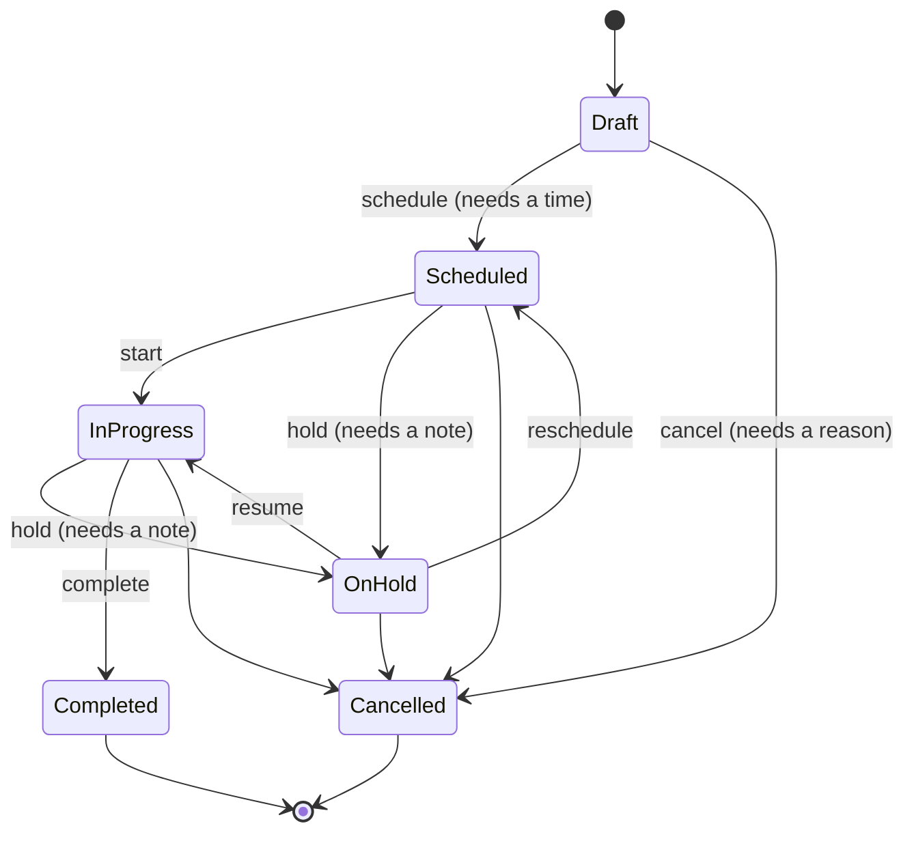
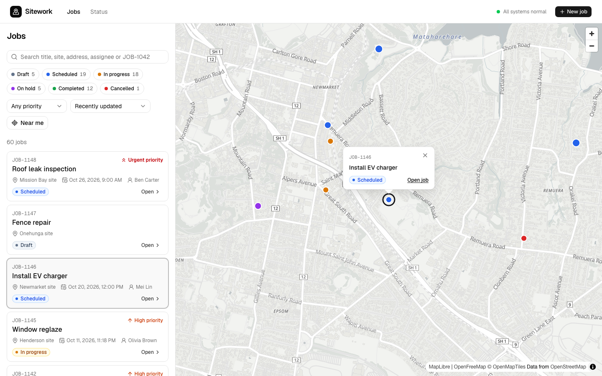
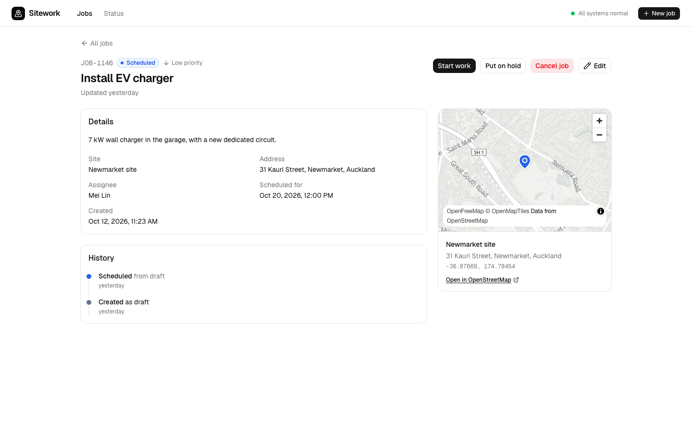
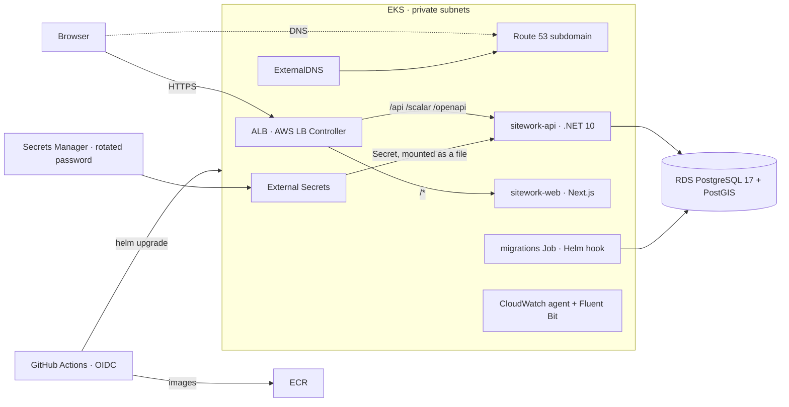

# Sitework

[](https://github.com/StephenDavid13/sitework/actions/workflows/ci.yml)

Coordinate work across many sites. Each **job** is pinned to a location on a map and moves through
a defined lifecycle. Coordinators plan and track it from a list beside a live map.





| Layer | Stack |
|---|---|
| Web | Next.js 16 (App Router), React 19, TanStack Query, nuqs, react-hook-form + zod, MapLibre + OpenFreeMap, Tailwind 4 + shadcn/ui |
| API | .NET 10 Minimal APIs, EF Core 10, PostgreSQL 17 + PostGIS, OpenAPI + Scalar, OpenTelemetry |
| Platform | AWS EKS (Graviton), RDS, ALB, Route 53, ACM, Secrets Manager, CloudWatch. Terraform, Helm 4, GitHub Actions (OIDC) |

## Features

- **Map and list workspace**:
  - Clustered markers coloured by status.
  - Filters for status, priority and free text. Text search covers title, site, address, assignee and `JOB-1042` references.
  - "Near me" radius search and "search this area" by bounding box.
  - Filters, page and selection all live in the URL, so any view can be shared.
- **Server-driven lifecycle.** Each job response lists the status changes allowed from its current state, and the UI renders buttons from that list. Holds and cancellations ask for a note; scheduling asks for a time. Completed and cancelled jobs are read-only, and every change is kept in a history timeline.
- **Live updates across users.** When anyone creates, edits or moves a job, every open list, map and job page refreshes within a second. Server-sent events are fanned out across API replicas by Postgres LISTEN/NOTIFY.
- **Data entry**:
  - Create and edit forms with a map location picker (click or drag a pin, or "use my location").
  - Address search with suggestions biased to the map. Dropping a pin fills in the nearest address. Both use OpenStreetMap data via Photon, proxied and cached by the API.
  - Client-side validation that mirrors the API's limits.
  - API validation errors shown on the matching fields.
- **Resilient UX**:
  - Skeletons, inline errors with retry, and optimistic status changes that roll back on failure.
  - A "changed by someone else" dialog on version conflicts (optimistic concurrency).
  - Not-found and error boundaries, plus an API health indicator.



## Architecture



- **One origin.** The ingress sends `/api` to the API and everything else to the web app, so there's no CORS. The Next.js build carries no environment-specific settings.
- **Contract first.** The API writes `openapi.json` on every build, and the web app generates its typed client from it. CI fails if either file is stale.
- **Migrations run once per release** as a Helm pre-upgrade hook, never at app startup. A failed migration rolls the release back.

[PLAN.md](PLAN.md) has the full plan and [docs/adr](docs/adr) the key decisions.

## Run it locally

Prerequisites: Docker, .NET SDK 10.0.3xx, Node 24, pnpm 10.

```bash
make setup   # restore .NET tools/packages and pnpm packages
make dev     # PostGIS + migrations/demo data + API (hot reload) + web
```

| What | Where |
|---|---|
| App | http://localhost:3000 |
| API docs (Scalar) | http://localhost:5080/scalar |
| OpenAPI | http://localhost:5080/openapi/v1.json |
| PostGIS | `localhost:55432`, database/user/password `sitework` |

To run the real Helm chart locally on kind, behind Traefik, use `make kind-all` and then open
http://sitework.localhost:8080 ([deploy/local/README.md](deploy/local/README.md)).

## Tests and quality gates

| Command | What it runs |
|---|---|
| `make test-api` | 110 xUnit tests: exhaustive lifecycle matrix, domain rules, live updates through the real Postgres trigger, geocoding against a fake upstream, and API integration tests against real PostGIS (Testcontainers) |
| `make test-web` | 51 Vitest + Testing Library + MSW tests: loading, error, retry, validation, conflict, optimistic rollback, live-update batching, address search |
| `make e2e` | 12 Playwright tests (desktop and mobile), including axe accessibility checks and a two-user live-update scenario. CI runs them against the chart deployed on kind |
| `make lint` | ESLint, `tsc`, Prettier |
| `make contract-check` | OpenAPI document and TypeScript client are in sync with the code |
| `make helm-lint` / `make helm-scan` | helm lint, kubeconform (K8s 1.37 + CRDs), Trivy |
| `make tf-validate` / `make tf-scan` | `terraform validate` for every stack, Trivy |

[CI](.github/workflows/ci.yml) runs all of these on every pull request:

- It also builds both images, deploys them with the Helm chart to a kind cluster, scans the images with Trivy, and runs the Playwright suite against that deployment.
- On `main`, the same checks gate the deploy to AWS.
- Actions are pinned to commit SHAs, and Dependabot keeps every ecosystem current.

## Deploy to AWS

The infrastructure is four Terraform stacks:

| Stack | Contents |
|---|---|
| `bootstrap` | State bucket |
| `foundation` | DNS zone, ECR, CI role |
| `infra` | VPC, EKS, RDS, certificate |
| `platform` | Cluster add-ons |

Deploys come from GitHub Actions via OIDC, so no long-lived keys are stored. Follow
[deploy/terraform/README.md](deploy/terraform/README.md):

```bash
make tf-bootstrap tf-apply-foundation   # then delegate the subdomain if its parent isn't in Route 53
make tf-apply-infra tf-apply-platform
gh variable set AWS_DEPLOY_ROLE_ARN --body "$(terraform -chdir=deploy/terraform/envs/dev/foundation output -raw ci_role_arn)"
git push                                # CI builds, pushes, migrates and deploys
```

If your AWS organization blocks GitHub OIDC providers, set `enable_github_deploy = false` and
release from your machine with `make aws-release` instead of the `gh variable set` step.

Running it costs about US$8–9 a day. Images are multi-arch, so the nodes can be Graviton
(default) or x86. AWS Free-plan accounts need the x86 Free Tier type; see
[deploy/terraform/README.md](deploy/terraform/README.md). To tear down, run `helm uninstall`, then destroy `platform`, then `infra`. `foundation` stays.
Day-2 operations (rollbacks, logs, scaling, secrets) are in [docs/runbook.md](docs/runbook.md).

## Production readiness

- **Security**:
  - There are no logins by design for now, so the API rate-limits per client IP and only trusts `X-Forwarded-For` from the VPC.
  - CSP, HSTS and frame denial are set on the web app; nosniff and related headers on the API.
  - Containers run as non-root with read-only root filesystems and all capabilities dropped. Pod Security is restricted.
  - IAM is least-privilege per controller via Pod Identity. RDS is private and encrypted.
  - AWS WAF on the load balancer: a per-IP rate limit plus AWS managed rules for common exploits, known-bad inputs and IP reputation.
  - Image and IaC scans run in CI.
- **Secrets**:
  - No secrets in the repo, images or Terraform outputs.
  - The database password is RDS-managed and rotated. It reaches pods through External Secrets as a mounted file, which the API re-reads, so a rotation needs no restart.
- **Reliability**:
  - At least two replicas with PDBs and an HPA (2–4).
  - Zone spread, readiness gates, a preStop drain and zero-downtime rollouts.
  - Liveness and readiness probes are kept separate.
  - Transient database errors are retried. Migrations run as a hook with automatic rollback.
- **Observability**:
  - Structured JSON logs go to CloudWatch Logs (Container Insights, 14-day retention).
  - OpenTelemetry traces and metrics (HTTP, SQL, runtime) go to the CloudWatch agent, which forwards traces to X-Ray. Any OTLP endpoint works via `api.telemetry.otlpEndpoint`.
  - RFC 9457 problem details carry trace IDs.
- **Data integrity**:
  - The server enforces the lifecycle rules.
  - Optimistic concurrency uses Postgres `xmin`, so conflicting writes get a `409 stale_version`.
  - The audit trail is written in the same transaction as each change.

## Repository layout

```
apps/api           .NET solution: src/Sitework.Api, tests/{UnitTests,IntegrationTests}, Dockerfile
apps/web           Next.js app: src/app (routes), src/features/jobs, src/lib/api (generated client), e2e/
deploy/helm        sitework chart (values for local and AWS)
deploy/local       kind + Traefik + PostGIS for running the chart locally
deploy/terraform   bootstrap and envs/dev/{foundation,infra,platform}
docs               runbook and architecture decision records
```
